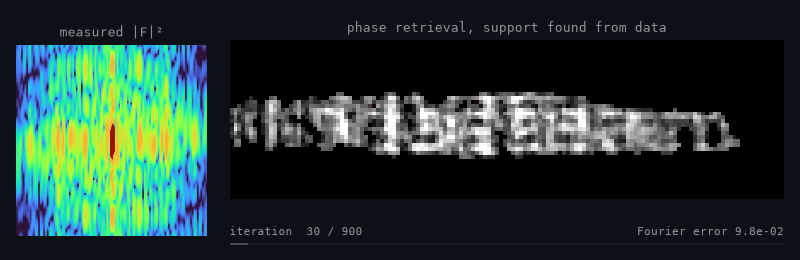

<h1>Isaac Yong (용이삭)</h1>

<b>X-ray physics · Scientific computing</b> M.S. student in Physics, Sogang University

<b><a href="https://nanisaac.github.io">Website</a></b> &nbsp;·&nbsp; <b><a href="https://nanisaac.github.io/notes/">Notes</a></b> &nbsp;·&nbsp; <b><a href="https://nanisaac.github.io/stats/">Stats</a></b> &nbsp;·&nbsp; <b><a href="https://blog.naver.com/sjbpepper">Blog</a></b> &nbsp;·&nbsp; <b><a href="mailto:isaacyong@naver.com">Email</a></b>

Only the intensity |F|² goes in. [QoraPhase](https://github.com/NaNIsaac/QoraPhase) recovers the lost phase and the object; <a href="./scripts/name_gif.py">script</a>.

I study X-ray scattering and diffraction, and build the software around the experiment:
simulation, inverse problems, coherent imaging, and beamtime data analysis.
Longer write-ups live on [my website](https://nanisaac.github.io).

**Now:** poster P2.17 at the KPS 2026 Fall Meeting, Jeju, 22 October:
transient formation of acoustic Bragg satellites ([TraTT](https://github.com/NaNIsaac/TraTT)).

### Selected work

| Science | Tools |
|---|---|
| [QoraPhase](https://github.com/NaNIsaac/QoraPhase) · JAX phase retrieval for CDI and BCDI | [codigest](https://github.com/NaNIsaac/codigest) · codebase, diffs and terminal output as LLM context |
| [QoraPhaseCU](https://github.com/NaNIsaac/QoraPhaseCU) · phase retrieval in C++/CUDA, with a measured optimization log | [deai](https://github.com/NaNIsaac/deai) · strip AI co-author trailers from git history |
| [QoraHolo](https://github.com/NaNIsaac/QoraHolo) · holotomography (ODT) reconstruction in C++/CUDA | [hanfix](https://github.com/NaNIsaac/hanfix) · re-run commands typed in the Korean layout |
| [ReflectoLearn](https://github.com/NaNIsaac/ReflectoLearn) · differentiable X-ray reflectivity fitting | [clippath](https://github.com/NaNIsaac/clippath) · clipboard screenshot to a file path for terminal agents |
| [QoraFlow](https://github.com/NaNIsaac/QoraFlow) · time-resolved X-ray data at PAL-XFEL | [roi_rectangle](https://github.com/NaNIsaac/roi_rectangle) · rectangular ROIs for NumPy images |
| [TraTT](https://github.com/NaNIsaac/TraTT) · time-dependent Takagi-Taupin diffraction | |
| [xray.ooguy](https://xray.ooguy.com) · offline calculators for old beamline PCs | |

### Upstream

<!-- contrib:start -->
- `Q07K/prompt-gallery` [Make accessories optional in X-ray film photo guidance](https://github.com/Q07K/prompt-gallery/pull/21) merged
- `Q07K/prompt-gallery` [Add hospital X-ray film prompt with approved example](https://github.com/Q07K/prompt-gallery/pull/18) merged
- `pydata/xarray` [DOC: Link windowed operations tutorial from computation guide](https://github.com/pydata/xarray/pull/11720) merged
- `dkriegner/xrayutilities` [feat(KinematicalMultiBeamModel): optional non-integer thicknesses](https://github.com/dkriegner/xrayutilities/pull/248) open
- `tomopy/tomopy` [DOC: Describe the roi argument of normalize_roi correctly](https://github.com/tomopy/tomopy/pull/664) open
- `clatlan/cdiutils` [Fix int32 overflow in SpaceConverter.get_transformation_matrix](https://github.com/clatlan/cdiutils/pull/112) open
<!-- contrib:end -->

Pepper (후추), my black-and-tan Shiba Inu, takes care of the contribution garden.

<picture>
  <source media="(prefers-color-scheme: dark)"
          srcset="./assets/pepper/pepper-harvest-dark.svg" />
  <source media="(prefers-color-scheme: light)"
          srcset="./assets/pepper/pepper-harvest-light.svg" />
  
</picture>

Formerly SJB7777; renamed to NaNIsaac in October 2026.
