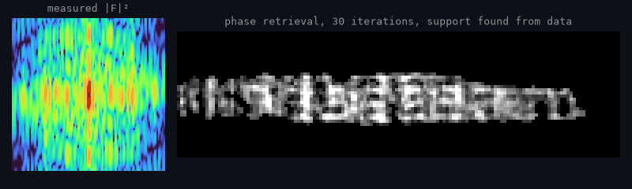

# Isaac Yong (용이삭)

**X-ray physics · Scientific computing**

Only the intensity |F|² goes in. [QoraPhase](https://github.com/NaNIsaac/QoraPhase) recovers the lost phase and the object; <a href="./scripts/name_gif.py">script</a>.

M.S. student in Physics at Sogang University.

I study X-ray scattering and diffraction, and build the software around the experiment:
simulation, inverse problems, coherent imaging, and beamtime data analysis.
Longer write-ups live on [my website](https://nanisaac.github.io).

**Now:** poster P2.17 at the KPS 2026 Fall Meeting, Jeju, 22 October:
transient formation of acoustic Bragg satellites ([TraTT](https://github.com/NaNIsaac/TraTT)).

| Science | Tools |
|---|---|
| [QoraPhase](https://github.com/NaNIsaac/QoraPhase) · JAX phase retrieval for CDI and BCDI | [codigest](https://github.com/NaNIsaac/codigest) · codebase, diffs and terminal output as LLM context |
| [ReflectoLearn](https://github.com/NaNIsaac/ReflectoLearn) · differentiable X-ray reflectivity fitting | [deai](https://github.com/NaNIsaac/deai) · strip AI co-author trailers from git history |
| [QoraFlow](https://github.com/NaNIsaac/QoraFlow) · time-resolved X-ray data at PAL-XFEL | [hanfix](https://github.com/NaNIsaac/hanfix) · re-run commands typed in the Korean layout |
| [TraTT](https://github.com/NaNIsaac/TraTT) · time-dependent Takagi-Taupin diffraction | [clippath](https://github.com/NaNIsaac/clippath) · clipboard screenshot to a file path for terminal agents |
| [xray.ooguy](https://xray.ooguy.com) · offline calculators for old beamline PCs | [roi_rectangle](https://github.com/NaNIsaac/roi_rectangle) · rectangular ROIs for NumPy images |

**Upstream**

<!-- contrib:start -->
- [Q07K/prompt-gallery](https://github.com/Q07K/prompt-gallery) · [Make accessories optional in X-ray film photo guidance](https://github.com/Q07K/prompt-gallery/pull/21) · merged
- [Q07K/prompt-gallery](https://github.com/Q07K/prompt-gallery) · [Add hospital X-ray film prompt with approved example](https://github.com/Q07K/prompt-gallery/pull/18) · merged
- [dkriegner/xrayutilities](https://github.com/dkriegner/xrayutilities) · [feat(KinematicalMultiBeamModel): optional non-integer thicknesses](https://github.com/dkriegner/xrayutilities/pull/248) · open
- [tomopy/tomopy](https://github.com/tomopy/tomopy) · [DOC: Describe the roi argument of normalize_roi correctly](https://github.com/tomopy/tomopy/pull/664) · open
- [clatlan/cdiutils](https://github.com/clatlan/cdiutils) · [Fix int32 overflow in SpaceConverter.get_transformation_matrix](https://github.com/clatlan/cdiutils/pull/112) · open
- [pydata/xarray](https://github.com/pydata/xarray) · [DOC: Link windowed operations tutorial from computation guide](https://github.com/pydata/xarray/pull/11720) · merged
- [python/cpython](https://github.com/python/cpython) · [gh-159190: IDLE: Show full syntax error diagnostics in Shell](https://github.com/python/cpython/pull/159189) · open
<!-- contrib:end -->

### Pepper's Harvest

Pepper (후추), my black-and-tan Shiba Inu, takes care of the contribution garden.

<picture>
  <source media="(prefers-color-scheme: dark)"
          srcset="./assets/pepper/pepper-harvest-dark.svg?v=2" />
  <source media="(prefers-color-scheme: light)"
          srcset="./assets/pepper/pepper-harvest-light.svg?v=2" />
  
</picture>

[Website](https://nanisaac.github.io) ·
[Notes](https://nanisaac.github.io/notes/) ·
[X-ray tools](https://xray.ooguy.com) ·
[Email](mailto:isaacyong@naver.com)

Note: My GitHub username was changed from "SJB7777" to "NaNIsaac" in October 2026.
