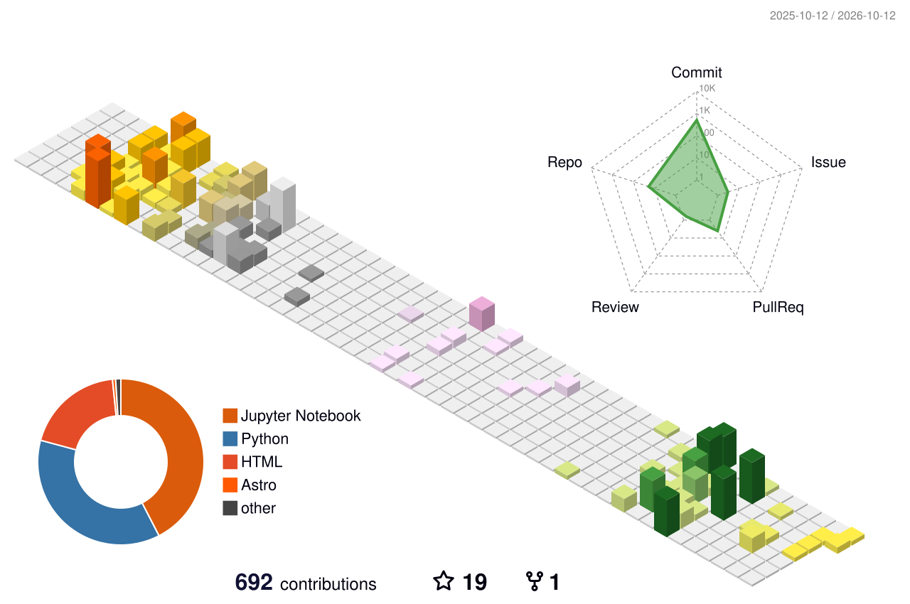

# Isaac Yong (용이삭)

**X-ray physics · Scientific computing**

M.S. student in Physics at Sogang University.

I study X-ray scattering and diffraction, and build scientific software
for simulation, inverse problems, coherent imaging, and experimental data analysis.

## Things I Build

### [QoraFlow](https://github.com/NaNIsaac/QoraFlow)
A scientific data toolkit for processing and analyzing
time-resolved X-ray experiments at PAL-XFEL.

### [ReflectoLearn](https://github.com/NaNIsaac/ReflectoLearn)
Differentiable X-ray reflectivity modeling, neural inference,
and physics-based refinement for thin-film inverse problems.

### [QoraPhase](https://github.com/NaNIsaac/QoraPhase)
A JAX-native, composable phase-retrieval framework
for coherent diffraction imaging.

### [TraTT](https://github.com/NaNIsaac/TraTT)
Time-dependent dynamical X-ray diffraction simulations
for transient acoustic Bragg satellites.

### [xray.ooguy](https://github.com/NaNIsaac/xray_ooguy)
Offline X-ray calculators and beamtime tools designed
to run on the machines actually sitting in the hutch.

**Also:**  
[roi_rectangle](https://github.com/NaNIsaac/roi_rectangle) ·
[codigest](https://github.com/NaNIsaac/codigest) ·
[QoraGeom](https://github.com/NaNIsaac/QoraGeom)

## Contributions

  

---

[xray.ooguy.com](https://xray.ooguy.com) ·
[Email](mailto:isaacyong@naver.com)
